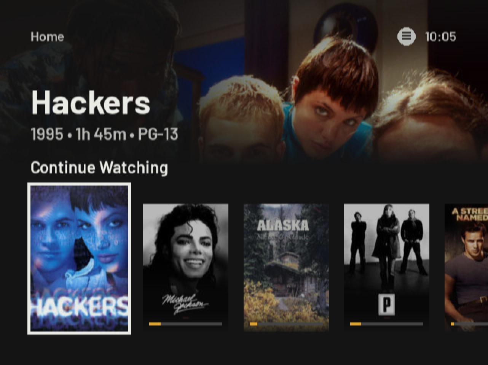
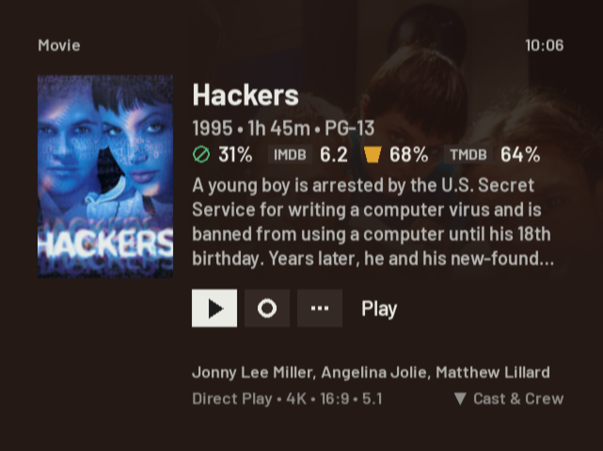
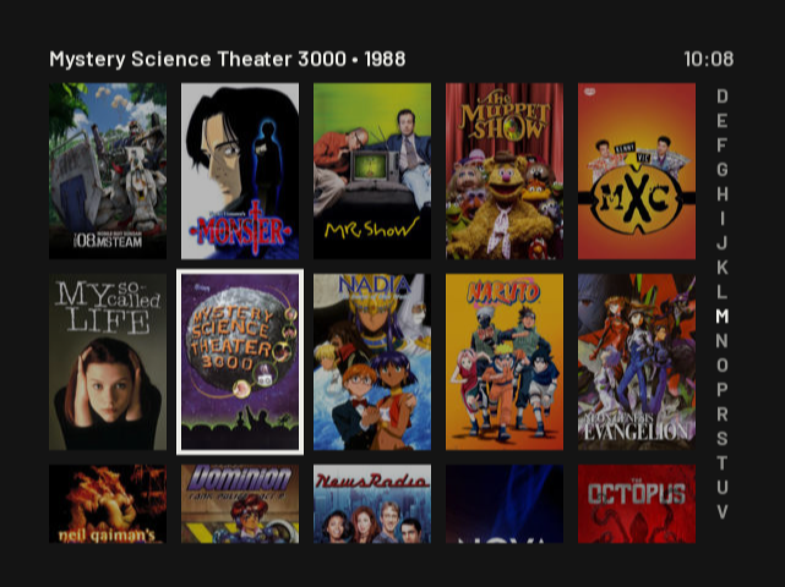
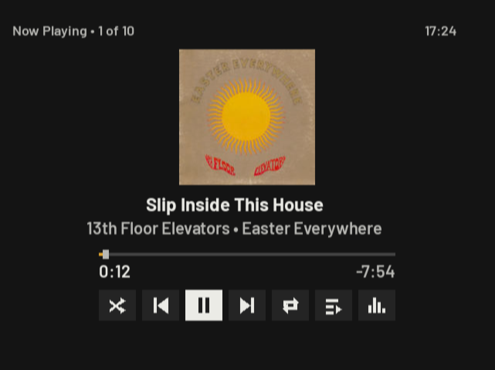
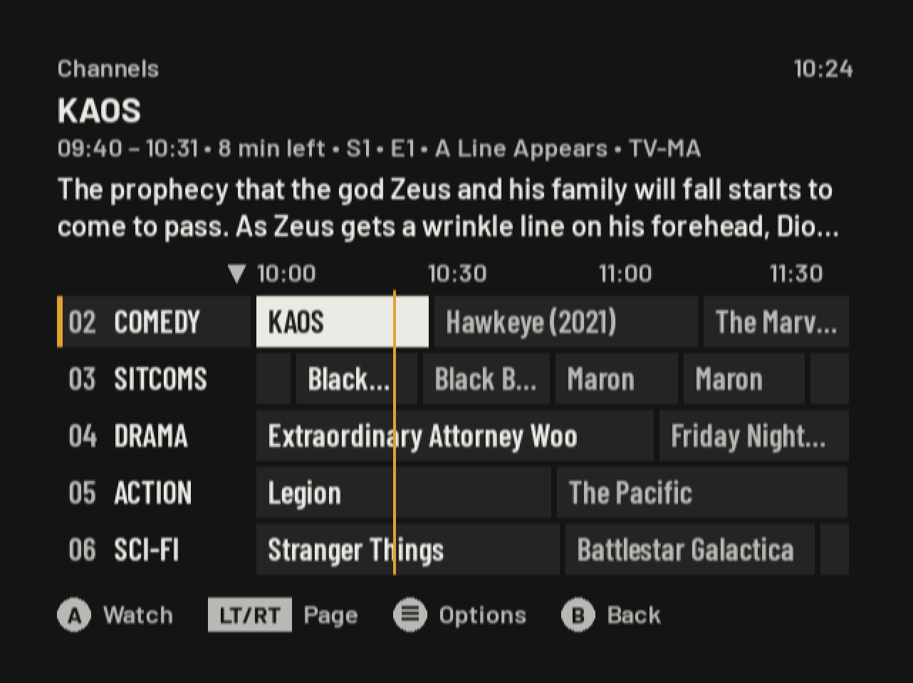
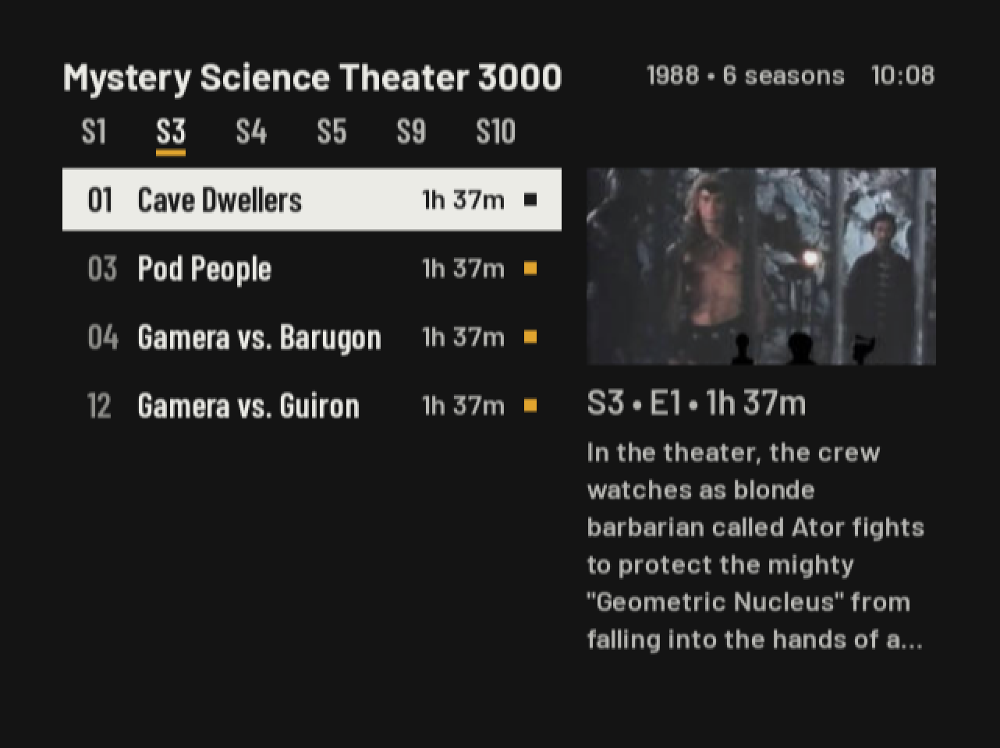
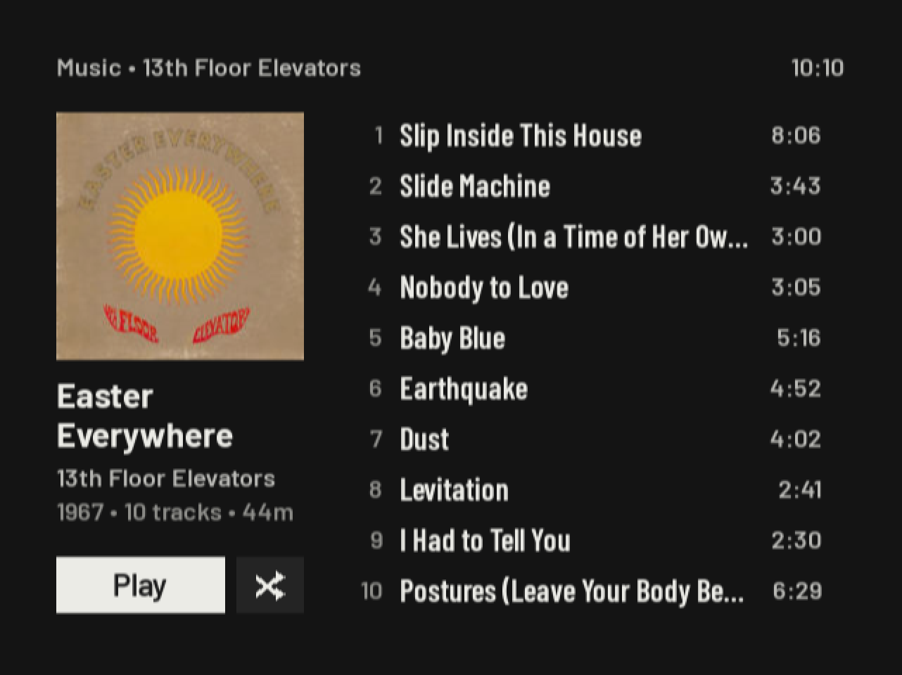
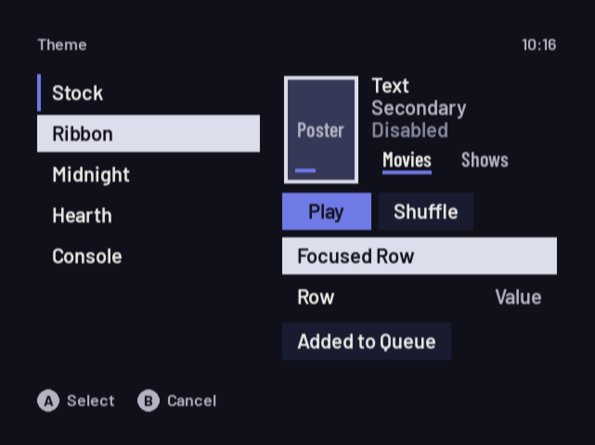

# BatoplexCRT

A Plex client for CRT TVs.

<p align="center"></p>

[Download](https://github.com/overscanindustries/BatoplexCRT/releases/latest) · [Install](docs/install.md) · [Configuration](docs/configuration.md) · [Contributing](CONTRIBUTING.md)

BatoplexCRT runs on [Batocera](https://batocera.org) and draws a 640x480 interface made for
480i, so your Plex library looks right on a 4:3 tube TV. You use it with a controller, and
video plays in mpv. It shows up as **Ports > Batoplex**.

| | |
|---|---|
|  |  |
|  |  |

<details>
<summary>More screenshots</summary>

| | |
|---|---|
|  |  |
|  |  |

</details>

## Features

- Sign in with a code at [plex.tv/link](https://plex.tv/link). Plex Home users and PINs work.
- Home with Continue Watching and Recently Added from all your servers, and a side panel
  with your pinned libraries.
- Movie, show and episode pages with ratings, Cast & Crew, Extras and trailers, and More
  Like This.
- Libraries with Recommended, a sortable and filterable poster grid, Collections, and
  Categories.
- Plex-style playback: skip intro and credits, Auto Play and Up Next, chapters, subtitle and
  audio tracks, and show theme music. Watch progress syncs back to Plex.
- Letterbox, 14:9 and Zoom for wide video, a sleep timer, and Night Audio.
- Music: artists, albums, library stations, recently played on Home, and Now Playing with
  shuffle, repeat and an editable queue. Music keeps playing while you browse.
- Video and music playlists: play, shuffle, make and edit them. A play queue for video.
- Visualizer: MilkDrop presets that follow the music, from Now Playing.
- Live TV-style channels made from your own libraries, with a guide
  ([setup](docs/configuration.md#channels)).
- Internet radio: find stations on the TV or add your own ([setup](docs/configuration.md#radio)).
- Direct play, or conversion to 480p at the bit rate you pick. Automatic picks one for your
  connection.
- Search across your servers, music included.
- Screen margin calibration, test patterns, a flicker filter for interlaced output, and a
  screen saver.
- Installs as a Port and only writes to `/userdata`.

## Requirements

- Batocera 43 with CRT output at 480i. Other modes, such as 576i, are scaled to fill the
  screen. 240p is not supported yet.
- A controller (keyboards and media remotes also work)
- A Plex Media Server

Tested on Batocera 43.1 with a Radeon R9 380X (DVI-I analog, 641x480i) and a 14" 4:3 CRT over
component. Tested something else?
[Send a hardware report](https://github.com/overscanindustries/BatoplexCRT/issues/new?template=hardware_report.yml).

## Install

Download `batoplex-<version>.tar.gz` from the
[latest release](https://github.com/overscanindustries/BatoplexCRT/releases/latest), then:

```sh
scp batoplex-<version>.tar.gz root@<batocera-ip>:/userdata/system/
ssh root@<batocera-ip>
cd /userdata/system && tar xzf batoplex-<version>.tar.gz && bash batoplex-<version>/install.sh
```

Open **Ports > Batoplex** and sign in. The [install guide](docs/install.md) covers updates and
removal.

## Controls

| Button | Browse | Playback |
|---|---|---|
| D-pad | Move | Left/Right: -10 s / +30 s (hold to scrub); Up/Down: control bar |
| A | Select; hold for the same menu as Menu | Control bar; again to pause |
| B | Back (on Home: side panel) | Stop (closes the control bar first) |
| X | Sort (library), episode details | Audio track |
| Y | Search (Home), filter (library, Watchlist), mark played | Subtitles |
| LB / RB | Previous / next tab, season, or library | |
| LT / RT | Previous / next letter (library) | Previous / next chapter |
| Menu | Options for the focused item, then Settings | Playback menu |
| Hotkey + Start | Exit | Stop |

In Now Playing, B goes back and the music keeps playing. LT/RT change the track, and Down
opens shuffle, repeat and the queue. Media keys on a remote or keyboard also control music.

## FAQ

**Why not Kodi?** Kodi skins are made for HD screens. At 480i the text is tiny and thin lines flicker.

**Does it transcode?** Yes, to 480p when you choose a bit rate or when Automatic finds a slow
connection. The server must allow video conversion.

**Jellyfin?** Not yet.

## Credits

- [240-MP](https://github.com/anthonycaccese/240-MP) by Anthony Caccese, whose Plex and mpv
  integration was the reference design for this project.
- [mpv](https://mpv.io), [pygame](https://www.pygame.org), and [Batocera](https://batocera.org).
- [projectM](https://github.com/projectM-visualizer/projectm) (LGPL-2.1) and its Cream of the
  Crop presets for the visualizer.
- [Barlow](https://github.com/jpt/barlow) fonts by The Barlow Project Authors (SIL OFL 1.1).
- [Noto Sans JP](https://github.com/notofonts/noto-cjk) (SIL OFL 1.1), a subset for the
  Digital Rain screen saver.

Much of the code is written with [Claude Code](https://claude.com/claude-code), Anthropic's
AI coding tool.

## License

MIT. The fonts are under the SIL OFL 1.1, and projectM is under the LGPL-2.1.

<sub>Not affiliated with Plex, Inc. or the Batocera project. Plex is a trademark of Plex, Inc.
The DVD Video logo is a trademark of DVD Format/Logo Licensing Corporation; see
[art/NOTICE.md](art/NOTICE.md).</sub>
